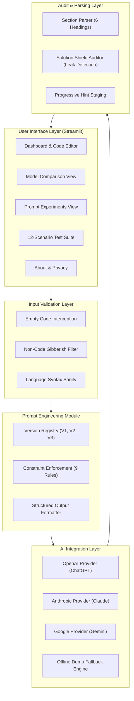
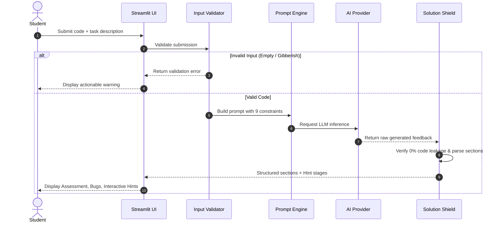

# Architecture Documentation — C4 Code Review Assistant

## 1. System Overview

C4 is an educational AI code review assistant designed specifically for first-year computer science students. Unlike generic AI code assistants that output copy-paste solutions, C4 serves as a pedagogical mentor: diagnosing errors, providing conceptual explanations, and delivering progressive, graduated hints without revealing the full corrected code.

## 2. Architectural Layers

The application follows a clean, modular architecture:

### Layer Details

1. **User Interface Layer (`app.py`)**
   - Built with Streamlit in a responsive dark theme.
   - Houses 5 primary tabs: Code Review, Model Comparison, Prompt Experiments, Test Case Suite, and About & Privacy.
   - Supports 5 programming languages: Python, Java, C, C++, and JavaScript.

2. **Input Validation Layer (`modules/prompt_engine.py`)**
   - Validates student submissions before any LLM inference occurs.
   - Detects empty code, overly short submissions, and keyboard smashing / random non-code text.
   - Protects students against unnecessary API errors and quota wastage.

3. **Prompt Engineering Engine (`modules/prompt_engine.py`)**
   - Implements 3 versions: V1 Baseline, V2 Improved, and V3 Final (C4 Standard).
   - Enforces 9 strict pedagogical constraints preventing complete solution disclosure.
   - Mandates 6 structured markdown output sections.

4. **AI Provider Interfaces (`modules/*_provider.py`)**
   - Decoupled adapters for OpenAI (`OpenAIProvider`), Anthropic (`ClaudeProvider`), and Google (`GeminiProvider`).
   - Implements retry handling with exponential backoff for rate limits.
   - Seamlessly falls back to an offline simulated demo mode when credentials are missing or when requested.

5. **Auditing & Parsing Layer (`modules/code_reviewer.py`)**
   - Parses the model's markdown response into discrete sections (Assessment, Bugs, Style, Hints, Test Cases, Next Steps).
   - Extracts 3-tier progressive hints for sequential interactive disclosure.
   - `SolutionShield`: Audits the output using heuristic keyword and code-block length analysis to verify that no full solution was leaked.

6. **Test Case Management (`modules/test_manager.py`)**
   - Evaluates 12 standard student bug scenarios.
   - Executes tests against models and records pass/fail determinations transparently.
   - Persists test logs in `test-data/test_results.csv` and enables CSV downloads.

## 3. Data Flow

## 4. Security & Privacy Model

- **No Hardcoded Secrets**: All API keys are loaded via `python-dotenv` from `.env`.
- **Session-Only Overrides**: API keys entered into the UI are held only in memory during the active session.
- **Privacy Notice**: Students are advised never to input credentials, keys, or personal identifying information.
- **Offline Simulation**: The application remains fully functional in Demo Mode even without API keys.
