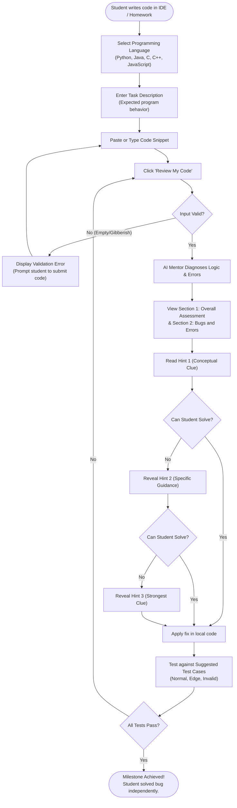

# Workflow Documentation — C4 Code Review Assistant

## 1. Student User Journey

The primary workflow guides first-year students through iterative debugging:

## 2. Multi-Model Comparison Workflow

1. **Select Code**: The student selects a bug scenario or keeps their current submission.
2. **Submit to All Models**: The user navigates to the **⚖️ Model Comparison** tab and clicks **"Run Comparison Across All 3 Models"**.
3. **Execution**:
   - The system queries **ChatGPT**, **Claude**, and **Gemini** using the exact same C4 Prompt Engine payload.
4. **Side-by-Side Review**:
   - Displays 3 synchronized columns.
   - Evaluates whether each model followed the *No Full Solution* restriction.
   - Compares explanation nuance, hint quality, and edge case coverage.

## 3. Prompt Experimentation Workflow

1. **Select Version**:
   - **V1 (Baseline)**: Standard assistant prompt without constraints.
   - **V2 (Improved)**: C4 mentor persona with basic negative constraints.
   - **V3 (Final)**: Complete C4 framework with 9 constraints, 6 structured sections, and progressive hints.
2. **Inspect Prompt**: The student reads the actual system instruction text to understand the prompt engineering behind it.
3. **Run Code**: The code is evaluated against the selected version.
4. **Analyze Difference**: The student observes how baseline prompts often spoil the answer, while V3 guides them with progressive clues.

## 4. Automated Test Suite Workflow

1. Navigate to **📊 Test Case Suite**.
2. Select one of the 12 prepared scenarios (e.g., *TC04 Off-by-one loop* or *TC05 Division by zero*).
3. Click **"Run Scenario"** or **"Run All 12 Test Scenarios"**.
4. The system evaluates the model's response transparently:
   - Verifies whether the expected error category was identified.
   - Audits whether full solutions were avoided.
   - Assigns a transparent **PASS** or **FAIL**.
5. Results are saved to `test-data/test_results.csv` and can be downloaded as a CSV report.
